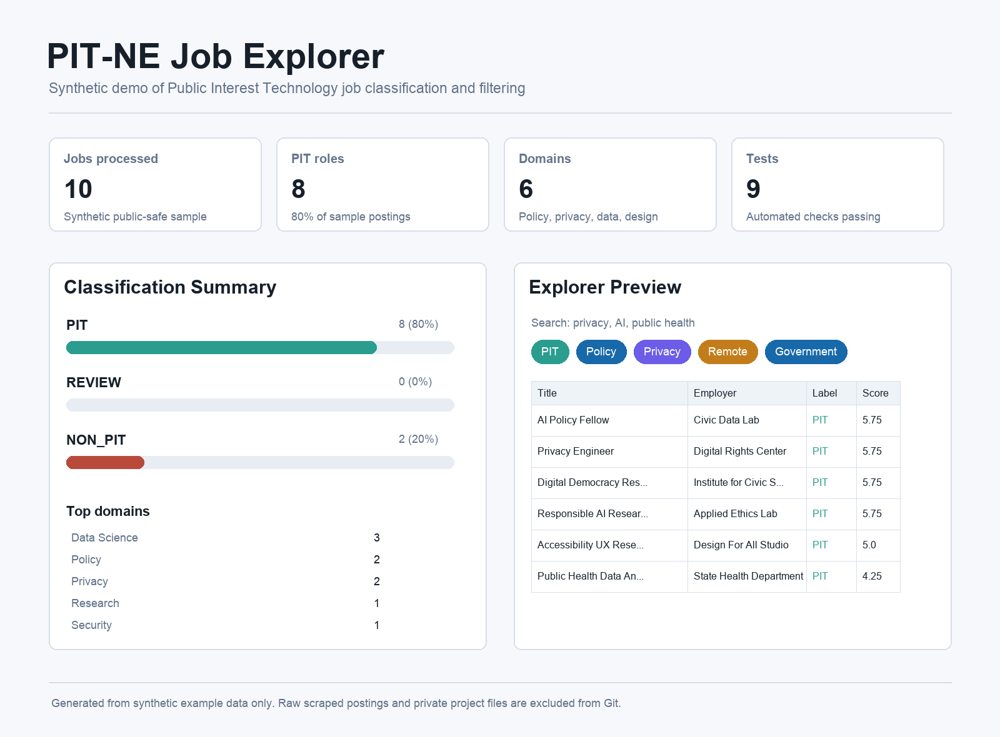

# PIT-NE Job Explorer

Portfolio-ready Python data pipeline and job explorer for collecting,
classifying, and visualizing Public Interest Technology job postings.

This repository is a public-safe rebuild of a school project for Public
Interest Technology New England. It includes synthetic examples, reusable
pipeline code, tests, and documentation. It does not include private meeting
notes, client contact information, API keys, or scraped job datasets that have
not been reviewed for sharing.

## Highlights

- Normalizes raw job posting exports into a consistent schema.
- Deduplicates postings using job URLs and title-employer-location keys.
- Classifies roles as `PIT`, `REVIEW`, or `NON_PIT` using transparent keyword
  and sector rules.
- Produces summary metrics by PIT label, domain, sector, experience level, and
  location type.
- Includes a lightweight Streamlit explorer for search and filtering.
- Uses synthetic example data so the public repository is safe to share.



## Portfolio Snapshot

The current synthetic demo processes 10 public-safe job postings, classifies 8
as `PIT` and 2 as `NON_PIT`, and summarizes roles across 6 inferred domains.
The project includes 9 automated tests covering normalization, deduplication,
classification, analysis, and CLI exports.

## Portfolio Materials

- `docs/methodology.md`: working PIT definition, classification rules, and
  source policy.
- `docs/data_dictionary.md`: canonical job-posting schema.
- `docs/architecture.md`: pipeline design and component responsibilities.
- `docs/resume_bullets.md`: role-specific resume bullet options.

## Tech Stack

- Python 3.10+
- pandas-ready CSV outputs
- Streamlit for the interactive job explorer
- pytest for automated tests

## Project Goal

Public Interest Technology jobs are not limited to traditional software
engineering roles. This project builds a repeatable workflow for identifying
roles that combine technology with public-interest goals such as privacy,
accessibility, digital rights, civic services, public health, fairness, and
governance.

## Workflow

```text
raw job postings
        |
        v
schema normalization
        |
        v
deduplication
        |
        v
PIT classification
        |
        v
summary analysis
        |
        v
CSV outputs + searchable job explorer
```

## Current Status

This first public version includes:

- synthetic job posting dataset
- normalization and deduplication logic
- rule-based PIT classification
- summary analysis exports
- Streamlit explorer scaffold
- automated tests for the core pipeline

Next planned steps:

1. Add scraper adapters only for sources that allow collection.
2. Add a reviewed coding guide and label audit workflow.
3. Add real-source adapters for permissioned or API-accessible job boards.
4. Add label-quality metrics from a reviewed sample set.

## Repository Structure

```text
.
├── app/
│   └── streamlit_app.py
├── data/
│   └── examples/
│       └── synthetic_job_postings.csv
├── docs/
│   ├── architecture.md
│   ├── data_dictionary.md
│   ├── methodology.md
│   ├── project_plan.md
│   └── resume_bullets.md
├── scripts/
│   └── run_sample_pipeline.py
├── src/
│   └── pit_ne_job_explorer/
│       ├── __init__.py
│       ├── analysis.py
│       ├── classification.py
│       ├── cli.py
│       ├── normalization.py
│       └── schema.py
├── tests/
├── pyproject.toml
├── requirements.txt
└── README.md
```

## Quick Start

```bash
python3 -m venv .venv
source .venv/bin/activate
pip install -r requirements.txt
pytest
```

Run the sample pipeline:

```bash
PYTHONPATH=src python scripts/run_sample_pipeline.py
```

Or run the CLI directly:

```bash
PYTHONPATH=src python -m pit_ne_job_explorer.cli \
  data/examples/synthetic_job_postings.csv \
  --jobs-output outputs/classified_jobs.csv \
  --summary-output outputs/job_summary.csv
```

Launch the explorer:

```bash
PYTHONPATH=src streamlit run app/streamlit_app.py
```

The Streamlit app reads `outputs/classified_jobs.csv` when available and falls
back to the synthetic example dataset.

## Data Policy

Raw scraped data, private project documents, and generated outputs are excluded
from Git. Public examples should be synthetic, permissioned, or aggregated.

## Current Limitations

- The public demo dataset is synthetic and intentionally small.
- PIT classification is rule-based and should be reviewed before use with real
  postings.
- Scraper adapters should only be added for sources that permit collection or
  provide approved APIs, feeds, exports, or permissioned data handoff.
